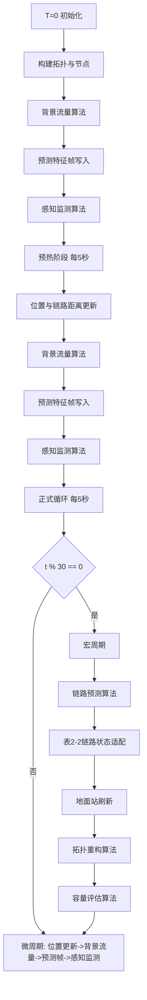

# src

大规模卫星网络状态感知与拓扑控制仿真验证系统的算法实现。

## 目录结构

```
src/
├─ main.py                仿真入口
├─ config.py              全局配置与星座切换
├─ simulation/
│  ├─ engine.py           主引擎（宏/微周期、线程、快照）
│  ├─ constellation.py    SGP4 卫星与 TLE 加载
│  ├─ topology_link_state.py  Walker 拓扑构建与刷新、链路物理计算
│  ├─ data_model.py       节点/拓扑数据结构
│  ├─ background_traffic_generation.py  背景流量（转发）
│  ├─ background_routing.py             中继路由（转发）
│  └─ groundstation_number_generation.py 地面站匹配
├─ algos/
│  ├─ background_traffic/       背景流量生成
│  ├─ capacity_evaluation/      容量分析与效能评估
│  ├─ data_generation/          多层关联数据模拟参数生成
│  ├─ sensing_monitoring/       感知监测
│  ├─ link_prediction/          链路预测与激光链路质量分析
│  └─ top_reconstruction/       拓扑重构
└─ utils/                 几何、轨道、地面站、TLE 工具
```

## 算法模块

| 模块 | 职责 | 对应接口 |
|---|---|---|
| `algos/background_traffic/` | 人口网格 → 卫星上传流量 → 星间中继 → 链路流量 | — |
| `algos/capacity_evaluation/` | 业务倍数 λ\*、瓶颈链路、端到端时延、丢包、误码、可用率与逐项判定 | 表2-19、表2-20 |
| `algos/data_generation/` | 物理公式与 CVAE 生成环境/物理/网络三层参数序列，并建立层间关联模型 | 表3-3、表3-4 |
| `algos/link_prediction/` | SCFE 双阶段预测与单链路状态适配 | 表2-2、表3-4 |
| `algos/sensing_monitoring/` | 物理层/网络层/环境/业务参数感知、覆盖率、采样健康度、两种网络层感知方法交叉核对、采样频率影响分析 | 表2-1、表3-2 |
| `algos/top_reconstruction/` | 链路价值评估、拓扑重构决策与拓扑质量指标 | 表2-8~2-12 |

## 仿真主流程

| 阶段 | 周期 | 步骤 |
|---|---|---|
| 初始化 | T=0 | 加载 TLE → 构建 Walker 四邻接拓扑 → 刷新 T=0 链路距离 → 背景流量 → 预测特征帧 → 感知监测 |
| 微周期 | 5 s | 卫星位置与链路距离 → 背景流量 → 链路物理同步 → 预测特征帧 → 感知监测 |
| 宏周期 | 30 s | 链路预测（SCFE）→ 表2-2 链路状态记录 → 地面站刷新 → 拓扑重构 → 容量分析与效能评估 → 预测精度统计 |

预测窗口为 30 个微周期（150 s）；拓扑重构生效（TopologyUpdate=1）后清空窗口，重新积累 150 s。

## 算法调用时序图



## 引擎算法调用白名单

下表描述的是主引擎真实调用链路（按当前 `simulation/engine.py`）。

| 算法目录 | 引擎是否调用 | 触发阶段 | 前端回传消息 |
|---|---|---|---|
| `algos/background_traffic/` | 是 | 初始化 + 预热 + 微周期 | `background_traffic_result` |
| `algos/link_prediction/` | 是 | 宏周期（窗口满 30 帧） | `link_prediction_result`、`link_prediction_accuracy` |
| `algos/top_reconstruction/` | 是 | 宏周期（预测后） | `topology_reconstruction_result`、`TOPOLOGY_METRICS`、`key_metrics` |
| `algos/sensing_monitoring/` | 是 | 初始化 + 预热 + 微周期 | `sensing_status` |
| `algos/capacity_evaluation/` | 是 | 宏周期（拓扑重构后） | `capacity_evaluation` |
| `algos/data_generation/` | 否（主循环不调用） | 离线数据生成流程 | 无 |

说明：当前版本已移除任务队列调度路径；`algos/task_planning/` 与 `algos/route_planning/` 不在 simple 工程主引擎调用链中。

## 前端订阅字段对接表

以下字段来自引擎当前实现，适合作为前端消息订阅与类型定义基线。

| 消息类型 | 触发时机 | 关键字段 | 说明 |
|---|---|---|---|
| topology_state_update | 微周期状态更新时（有增量链路） | constellation_id, timestamp, links, chunk_index, total_chunks | links 为链路增量列表；单片最多 500 条，需按分片合并。 |
| node_state_update | 微周期状态更新时 | constellation_id, timestamp, nodes | nodes 为节点全量覆盖列表。 |
| background_traffic_result | 初始化/预热/微周期 | 算法返回对象原样透传 | 作为背景业务流结果展示输入。 |
| sensing_status | 初始化/预热/微周期 | 感知算法状态对象（覆盖率、采样健康度、方法对比等） | 感知监测主输出。 |
| link_prediction_result | 宏周期预测完成后 | ConstellationId, Inference_time, LinksPredTopology, msg, chunk_index, total_chunks | 引擎会做热点链路筛选并按 5 个预测步长分片。 |
| link_prediction_accuracy | 宏周期窗口精度结算后 | TriggerTime, WindowStart, WindowEnd, Threshold, Accuracy, Correct, Total, EvaluatedFrames, ExpectedFrames, FrameResults | 链路可用率分类精度统计。 |
| TOPOLOGY_METRICS | 拓扑重构产出后 | TopQualities | 拓扑质量核心指标。 |
| topology_reconstruction_result | 拓扑重构完成后 | 重构结果对象原样透传（含 TopQualities/TopDifference 等） | 用于重构详情展示。 |
| capacity_evaluation | 拓扑重构后容量评估完成 | Capacity, Availability, Verdict 及评估窗口信息 | 表 2-20 评估结果。 |
| key_metrics | 宏周期完成后 | gw, delta | 关键指标看板聚合数据。 |

前端消费建议：

1. 对 topology_state_update 与 link_prediction_result 做分片重组后再渲染，避免闪烁与重复绘制。
2. node_state_update 采用整帧覆盖写入，避免增量错位导致的节点状态漂移。
3. 若 key_metrics 缺失，前端应允许显示占位值，避免阻塞主面板渲染。

## 链路物理

全工程只有一个链路物理实现：`simulation/topology_link_state.py` 的 `evaluate_link_physics_batch`。引擎链路状态同步、感知监测、表2-2 适配都调用它。

| 量 | 计算 |
|---|---|
| 天线增益 G | 10·lg((π·D/λ)²)，D = `LASER_APERTURE_DIAMETER_M`（0.085 m） |
| 接收功率 Rx | Tx + 2G + 20·lg(OpticsEfficiency) − 20·lg(4πd/λ) − PointingLossMax |
| PathLoss | Tx − Rx（dB） |
| SNR | min(Rx, RxPowerOperatingRange 上限) − RxSensitivity + 8.5 dB；Rx 超过上限时按终端可调衰减器压到上限 |
| BER | QPSK：0.5·erfc(√(SNR_lin/2))，SNR 加 9 dB FEC 净编码增益，为纠错后误码率 |
| AchievableRate | Rx ≥ 灵敏度：ModulationBandwidth；Rx < 灵敏度：ModulationBandwidth × 10^((Rx−灵敏度)/10)；上限 `MAX_LINK_SPEED_GBPS` |
| PacketLossRate | 1 − (1−(1−(1−BER)^12000))·(1−过载丢弃比例) |
| Delay | 传播 d/c + 发送 12000 bit/速率 + 排队 M/M/1 ρ/(1−ρ)·服务时间（ms） |
| LinkCapacity | = AchievableRate；MaxCapacity = `MAX_LINK_SPEED_GBPS` |

激光器类型按链路方向（同轨 RIGHT/LEFT、异轨 UP/DOWN）与星座确定：

| 星座 | 同轨 | 异轨 |
|---|---|---|
| 3600 | FAST | ROBUST |
| 432 | ROBUST | ROBUST |

激光器预设见 `config.py` 的 `LASER_CONFIG_PRESETS`，方向映射见 `SATELLITE_LASER_DIRECTION_TYPE_BY_CONSTELLATION`。

## 用户业务需求输入

`SimulationEngine.run_simulation(timestamp, constellation_id, tle_file_path, task_list)` 的 `task_list` 为用户业务需求列表，保存在 `SimulationEngine.task_list`，每个宏周期传给 `reconstruct_topology(..., task_list=...)`。当前版本拓扑重构接收该输入，决策仍以链路预测给出的业务强度为准。

| 字段 | 类型 | 值域 | 含义 |
|---|---|---|---|
| TaskId | String | — | 业务标识 |
| TaskType | String | Communication | 业务类型 |
| SourceGroundStationId | Int | 地面站编号 | 源地面站 |
| TargetGroundStationId | Int | 地面站编号 | 目的地面站 |
| DemandGbps | Float | >0 Gbps | 业务带宽需求 |
| Duration | Int | >0 s | 持续时间 |
| TaskPriority | Int | ≥1 | 优先级 |
| arrival_sim_time | String | ISO 8601 UTC | 到达时刻 |

## 引擎对外结果

| 属性 | 推送消息 | 内容 |
|---|---|---|
| `latest_sensing_status` | `sensing_status` | 感知监测输出（表2-1、表3-2），每微周期 |
| `latest_prediction_result` | `link_prediction_result` | SCFE 预测（热点链路分片推送），每宏周期 |
| `latest_link_state_records` | — | 表2-2 记录列表，每宏周期 |
| `_last_topology_reconstruction_result` | `topology_reconstruction_result` | 拓扑重构结果（表2-8~2-12） |
| `latest_capacity_evaluation` | `capacity_evaluation` | 容量分析与效能评估（表2-20），每宏周期 |

## 运行

依赖：`numpy`、`scipy`、`pandas`、`openpyxl`、`xlrd`、`rustworkx`、`pydantic`、`sgp4`、`torch`。

数据目录位于工程根（`src` 的同级）：

```
data/Delta_60_60_58_500_23.txt
data/Delta_24_18_50_1150_5.txt
data/Internet_area.xlsx
data/GroundStation.xls
```

启动仿真：

```bash
python -m src.main
```

星座在 `src/main.py` 的 `selected_constellation_id` 切换（`"3600"` / `"432"`）。

## 各模块自测

```bash
python src/algos/background_traffic/selftest.py
python src/algos/link_prediction/selftest.py
python src/algos/capacity_evaluation/selftest.py
python src/algos/top_reconstruction/selftest.py
```

感知监测在仿真主循环内运行，输出见 `algos/sensing_monitoring/README.md`。

## 单位

| 字段 | 单位 |
|---|---|
| 表2-2 `Capacity` | Gbps（剩余容量） |
| 表2-2 `PredFlow` | Gbps（额定容量 − 剩余容量） |
| 表2-2 `SignalIntensity` | dBm，[-80,-9] |
| 表2-2 `Delay` | s，[0,0.3] |
| 表2-2 `AchievableRate` | Gbps |
| 表2-2 `DelayJitter` | ms |
| 表2-11 `AvgLinkPropagationDelay` | ms |
| 表2-11 `TotalTransmissionCapacity` | Gbps |
| 表2-20 `Capacity*` / `AggregateGoodput` | Gbps |
| 表2-20 `MeanEndToEndDelay` / `P95EndToEndDelay` | ms |
| 表2-20 `DowntimeSeconds` | s |

## 测量数据

在本机（RTX 5070）实测：

| 环节 | 432 星 | 3600 星 |
|---|---|---|
| 位置刷新 | 0.02 s | 0.22 s |
| 背景流量 | 0.04 s | 0.66 s |
| 拓扑重构 | 0.17 s | 1.70 s |
| 容量评估（16 条业务） | 0.02 s | 0.30 s |
| SCFE 推理（1728 条链路） | 297 ms | — |
